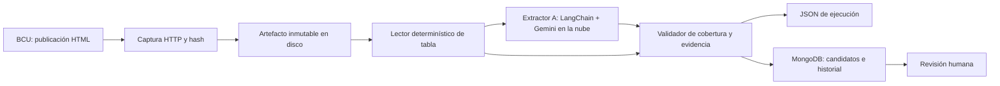
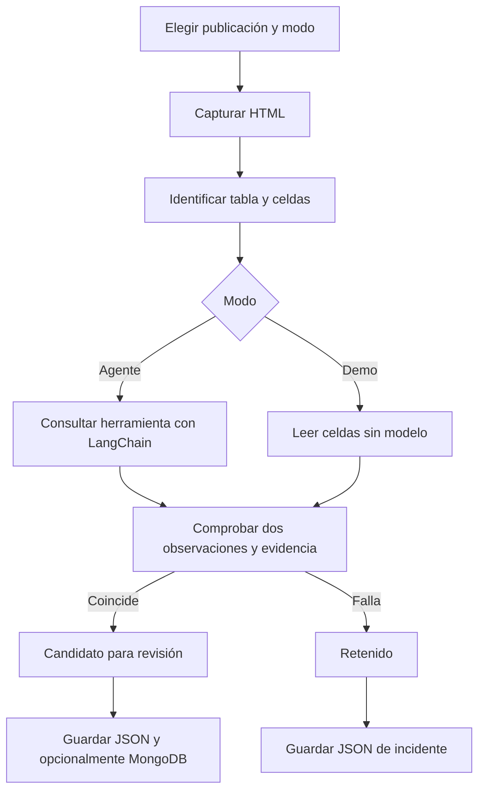

# Arquitectura y decisiones

## Componentes generales

## Actividades

## MongoDB frente a PostgreSQL

Elegimos MongoDB para **este prototipo de ingesta**, porque una ejecución reúne observaciones, evidencia anidada, metadatos y estados en un documento. PyMongo ofrece una integración directa y el esquema Pydantic mantiene reglas explícitas. No hace falta Atlas ni un servicio pago: se usa MongoDB local, restringido a localhost mediante Docker Compose.

PostgreSQL sería una buena opción para el Data Hub de series normalizadas: integridad entre entidades, consultas SQL, comparaciones temporales y agregaciones entre países. MongoDB no es universalmente mejor ni una decisión definitiva para todo LEIP. La colección de ejecuciones puede convivir con un Data Hub relacional más adelante. Antes de esa decisión, comparar consultas reales, volumen, índices, costo de operación y experiencia del equipo.

## LangChain frente a alternativas

LangChain responde a lo conversado en tutoría y ofrece agentes, herramientas y esquemas estructurados; usa LangGraph para ejecución. El proyecto usa `create_agent` y `ToolStrategy` con un modelo Gemini configurable en la nube. Se selecciona Gemini Developer API de AI Studio, evitando Vertex AI y proveedores de respaldo; su cuota gratuita permite probar con un proyecto Free tier. OpenAI se conserva como opción explícita. Un SDK directo simplificaría dependencias para una sola llamada; LangGraph explícito podría convenir cuando se agreguen ramas, colas y reintentos; otros frameworks requerirían evaluar soporte y complejidad.

No se usa Ollama ni otro modelo local. MongoDB y la captura/validación continúan siendo locales y consumen recursos modestos; solo la inferencia se traslada a Google. Una suscripción de consumidor a Gemini no prueba que la API de un proyecto sea gratuita. No se aprovisionan recursos en Azure.

## Próximas iteraciones

1. Probar el agente real con una clave API y comparar contra publicaciones verificadas manualmente.
2. Agregar extractores B/C con contexto independiente, sin compartir respuestas.
3. Implementar consenso sobre identidad, horizonte, unidad, valor y cobertura; no votar por mayoría.
4. Incorporar investigador de incidentes, propuestas de reparación y revisión humana.
5. Incorporar cola de tareas y programador que encole trabajos.
6. Agregar registros de fuentes, PDF/Excel y otras variables del BCU.
7. Diseñar Data Hub, índices y métricas de revisiones sin confundir horizontes móviles con fechas objetivo fijas.

El equipo debe revisar estas decisiones en conjunto. Esta documentación prepara esa discusión; no reemplaza la investigación ni el acuerdo del equipo.
